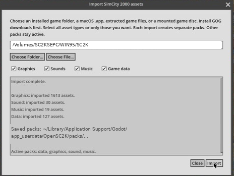
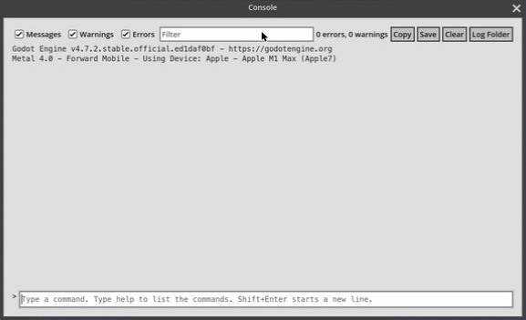

# simcity2000-se-mac

Play SimCity 2000 Special Edition natively on an Apple Silicon Mac, using your own CD and the open source OpenSC2K engine.

This repo holds two small helper scripts and the notes from getting it running. It is not a fork. OpenSC2K is not modified here. All the real work is theirs.

## What you need

1. Your own copy of SimCity 2000 Special Edition. The 1996 Windows 95 version gives the most complete import. The CD itself, a copy of the CD, a `.iso` of it, or an installed Windows 95 game folder all work. This repo contains no game data and never will.
2. An Apple Silicon Mac. OpenSC2K's Mac app needs macOS 13 or later on Apple Silicon.

## Setup

```sh
git clone https://github.com/GhostInTheBus/simcity2000-se-mac.git
cd simcity2000-se-mac
bash scripts/install_opensc2k.sh
bash scripts/check_sc2k.sh /path/to/your/SimCity2000.iso
```

The first script downloads the official OpenSC2K release, checks its SHA-256 and Apple notarization, and copies `OpenSC2K.app` into Applications.

The second script finds the Windows 95 game on your copy, checks that every file OpenSC2K wants is there, tells you which build you have, and copies the folder path to your clipboard. If you give it a `.iso` (or a `.zip` with the `.iso` inside, like the archive.org download), it mounts the disc read only.

Then the import, which only exists in the app's own window:

1. Open OpenSC2K and click Import Assets, then Import Original Assets.
2. Paste the path into the game folder field. Keep Graphics, Sounds, Music and Game data ticked.
3. Click Import once and wait for "Import complete".



A full import from the 1996 CD gives 1613 graphics, 30 sounds, 19 music tracks and 127 data files. After that, Start New City, Open City, Play Scenario and SCURK all light up.

## Checking it runs clean

Open the in game console with Cmd+Shift+J (or Windows > Console). It counts errors and warnings, and Save writes a log file. After a city loads and runs a few years at top speed, it should still read 0 errors, 0 warnings.



## Things worth knowing

Short version, details in [docs/TIL.md](docs/TIL.md):

* Click Import once. Clicking it twice makes two identical packs (about 20 MB each). Only the newest is used.
* Godot's own `godot.log` can stay empty in release builds. The in game console is the place to look.
* The "Biggest city in the world" sample city has property tax at 0%, so at top speed it goes broke and the mayor gets impeached about 12 game years in. That is the original game's rule, not a bug.

## Docs

* [docs/TIL.md](docs/TIL.md) what I learned getting this running
* [docs/ELI5.md](docs/ELI5.md) the whole thing explained simply
* [docs/disc-images.md](docs/disc-images.md) working with `.iso` files and the archive.org downloads

## Credits and legal

* [OpenSC2K](https://github.com/OpenSC2K/OpenSC2K) by Nicholas Ochoa and contributors, MIT. It does the heavy lifting.
* [sc2kfix](https://github.com/sc2kfix/sc2kfix), whose source showed how to tell the game builds apart.
* SimCity 2000 is a trademark of Electronic Arts. This project is not affiliated with or endorsed by Electronic Arts or Maxis. You must own a copy of the game.
* Scripts in this repo are MIT licensed, see [LICENSE](LICENSE).
